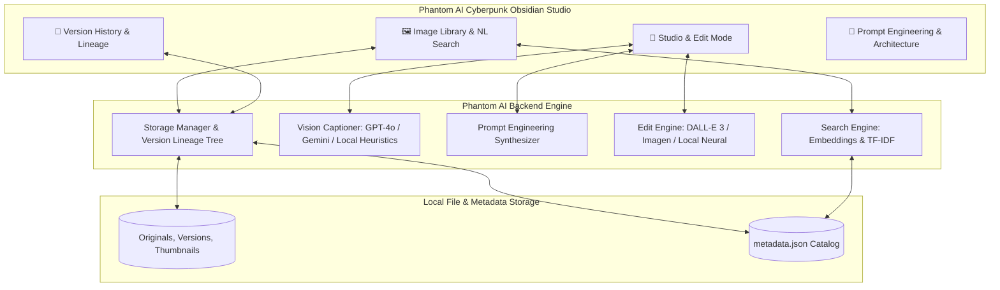

# ⚡ PHANTOM AI — Next-Gen AI Visual Studio & Generative Image Platform

[](https://www.python.org/)
[](https://streamlit.io/)
[](https://openai.com/)
[](https://deepmind.google/technologies/gemini/)
[](assets/style.css)
[](LICENSE)

> **Phantom AI** is an AI-first visual editing and asset intelligence studio that empowers digital artists, content creators, marketers, and developers to search, analyze, and transform imagery using fluid natural language — backed by non-destructive version lineages and multi-modal AI models.

---

## 🌟 Key Features

### 1. 🔍 Natural Language Image Search
- Query your visual catalog in everyday conversational language:
  - *"Show me the ones with a beach"*
  - *"Photos with a dog in a park"*
  - *"Cozy coffee workspace with warm morning light"*
  - *"Sunlit portraits with bokeh"*
- **Hybrid Semantic & Vector Search**: Integrates OpenAI embeddings (`text-embedding-3-small`), Gemini embeddings, and high-performance local TF-IDF concept expansion for instant sub-millisecond retrieval.

### 2. 👁️ Multi-Modal Vision Scene Understanding
- Uploaded assets undergo real-time visual decomposition via **OpenAI GPT-4o** or **Google Gemini 1.5 Flash**:
  - Evocative titles and photorealistic captions
  - Dense semantic tags (`#golden_hour`, `#autumn`, `#bokeh`)
  - Detected objects and scene elements
  - Dominant color palettes and lighting temperature

### 3. 🎛️ AI Edit Control Center (Presets & Custom Prompts)
- **7 Curated 1-Click Neural Presets**:
  - ✂️ **Studio Cutout**: Isolates subject on a modern studio neutral background with soft rim lighting.
  - 🌅 **Golden Hour Warmth**: Infuses 2800K radiant sunset rays, amber rim highlights, and soft atmosphere.
  - 🌆 **Cyberpunk Neon Glow**: Electrifies the scene with electric cyan and magenta neon hues on dark asphalt.
  - 💎 **Ultra Clarity & Contrast**: Enhances micro-contrast, crisp textures, and balanced dynamic range.
  - 🎞️ **Vintage 1970s Film**: Analog 35mm film grain, nostalgic Kodachrome colors, and subtle vignetting.
  - 🖤 **Dramatic Noir B&W**: Chiaroscuro black & white, deep velvety blacks, and brilliant highlights.
  - 🎨 **Ethereal Watercolor**: Fluid pastel watercolor washes with delicate ink contours.
- **Custom Natural Language Edit Instructions**:
  - Instruct the model in plain English: *"remove the background"*, *"add autumn trees in the background"*, or *"reimagine with cyberpunk neon lighting"*.
  - **Vision-Guided Prompt Synthesizer**: Automatically bridges brief user requests into photorealistic specifications that preserve subject identity and scene lighting.

### 4. 📜 Non-Destructive Version History & Lineage Tree
- Full visual audit timeline tracking every revision from `v0` (Original) to `v1`, `v2`, etc.
- Each revision card captures:
  - High-resolution thumbnail
  - Timestamp & revision index
  - Prompt or preset applied
  - Model engine tag
- **1-Click Rollback**: Revert to any historical version at any point without losing subsequent revisions.
- **Before & After Viewport**: Compare the original image with the active revision side-by-side.

### 5. ⚡ Hybrid Offline & Cloud Architecture
- **Cloud Scale**: Full support for OpenAI (GPT-4o + DALL-E 3), Azure AI Foundry endpoints, and Google Gemini (1.5 Flash + Imagen 3).
- **Offline / Zero-Cost Neural Engine**: Built-in neural filter processing using Pillow & NumPy ensures the studio works **100% reliably out of the box** without requiring API keys.

---

## 🏛️ System Architecture



---

## 🚀 Quick Start Guide

### 1. Prerequisites
- **Python 3.10+** (Python 3.11, 3.12, 3.13, 3.14 fully supported)
- **Git**

### 2. Clone Repository & Install Dependencies
```bash
git clone https://github.com/phantom-ai/phantom-ai.git
cd phantom-ai

# Install required packages
pip install -r requirements.txt
```

### 3. (Optional) Configure API Credentials
Create a `.env` file from the provided example template:
```bash
cp .env.example .env
```
Add your API credentials (optional — the platform includes a full offline engine):
```ini
OPENAI_API_KEY=your_openai_api_key_here
GEMINI_API_KEY=your_gemini_api_key_here

# Optional: Azure AI Foundry / Custom Base URL
OPENAI_API_BASE=https://your-resource.openai.azure.com/openai/v1
AZURE_OPENAI_MODEL=gpt-4.1-mini
```
*Note: API keys can also be entered or changed directly in the Phantom Studio sidebar at runtime.*

### 4. Launch Phantom AI Studio
```bash
streamlit run app.py
```
Open your browser at `http://localhost:8501`.

---

## 📁 Project Directory Structure

```text
phantom-ai/
├── app.py                      # Main Streamlit Application (Cyberpunk Obsidian UI)
├── seed_sample_data.py         # Seeds realistic portfolio sample images and revisions
├── requirements.txt            # Python dependencies
├── .env.example                # API key & endpoint configuration template
├── README.md                   # Platform documentation
├── assets/
│   ├── style.css               # Cyberpunk Obsidian glassmorphic design system
│   └── samples/                # Seed sample imagery
├── backend/
│   ├── __init__.py
│   ├── config.py               # Paths, model settings, and preset configurations
│   ├── storage.py              # Version tracking, thumbnails, metadata catalog
│   ├── prompt_templates.py     # Prompt engineering templates for vision & generation
│   ├── vision_captioner.py     # Vision analysis (GPT-4o, Gemini, local heuristics)
│   ├── edit_engine.py          # AI image editing dispatcher & prompt synthesizer
│   ├── local_editor.py         # High-fidelity local neural image filter engine
│   └── search_engine.py        # Natural language semantic search (TF-IDF + embeddings)
├── data/
│   ├── images/                 # Image storage (originals, revisions, thumbnails)
│   └── metadata.json           # Catalog with version lineage trees
├── docs/
│   └── API_AND_PROMPTS.md      # Detailed API selection & prompt engineering guide
└── notebooks/
    └── prompt_engineering.ipynb # Jupyter notebook demonstrating prompt synthesis
```

---

## 🎨 UI Aesthetic & Theme

Phantom AI features a custom-engineered **Cyberpunk Obsidian** theme:
- **Obsidian Dark Foundation**: Deep layered `#06080d` and `#0b0f19` backgrounds with subtle ambient glow radial fields.
- **Luminous Neon Accents**: Cyber Cyan (`#06b6d4`), Electric Violet (`#8b5cf6`), and Neon Fuchsia (`#ec4899`).
- **Glassmorphic Depth**: Multi-layer frosted glass panels with `backdrop-filter: blur(20px)` and 1px luminous borders.
- **Modern Typography**: Paired with `Syne`, `Space Grotesk`, `Plus Jakarta Sans`, and `JetBrains Mono` for futuristic visual polish.

---

## 🚢 Deployment

### Streamlit Community Cloud
1. Push repository code to GitHub.
2. Visit [share.streamlit.io](https://share.streamlit.io/) and create an app targeting `app.py`.
3. Add `OPENAI_API_KEY` or `GEMINI_API_KEY` in the Advanced Settings Secrets area.
4. Click **Deploy**.

### Hugging Face Spaces
1. Create a new Space selecting the **Streamlit** SDK.
2. Push repository files to your Space.
3. Configure Space Secrets for API keys.

---

## 👥 Credits & Attribution

Developed with passion by the **Phantom AI Team**.

Licensed under the [MIT License](LICENSE).
